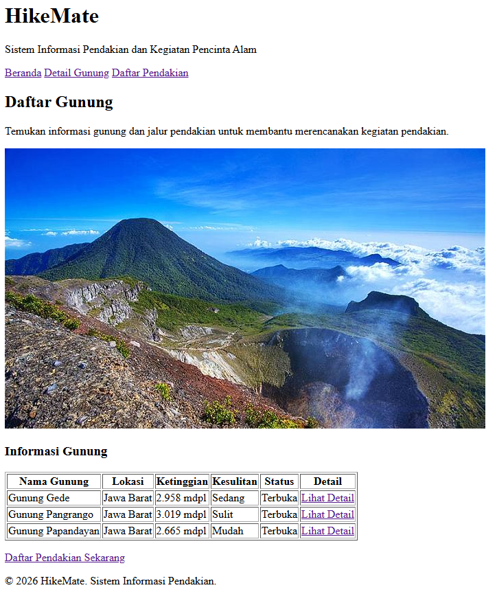
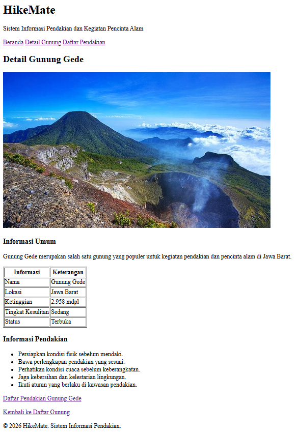
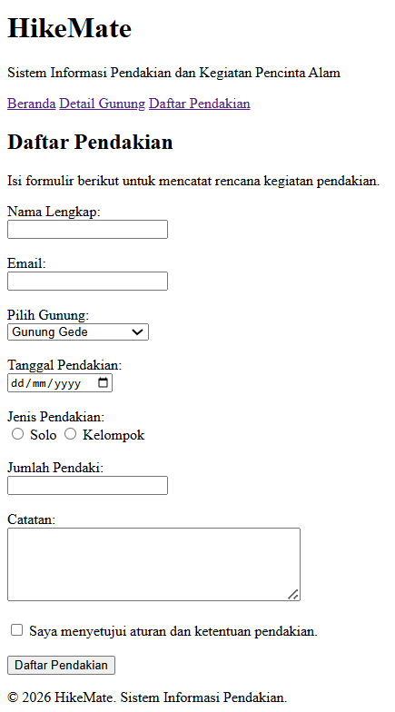
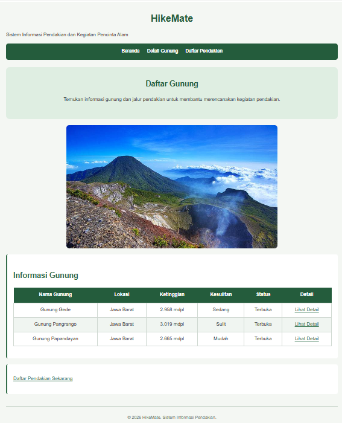
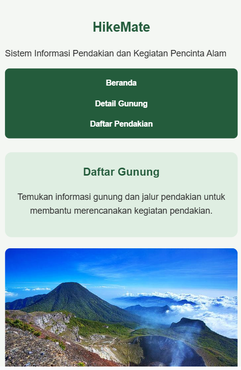
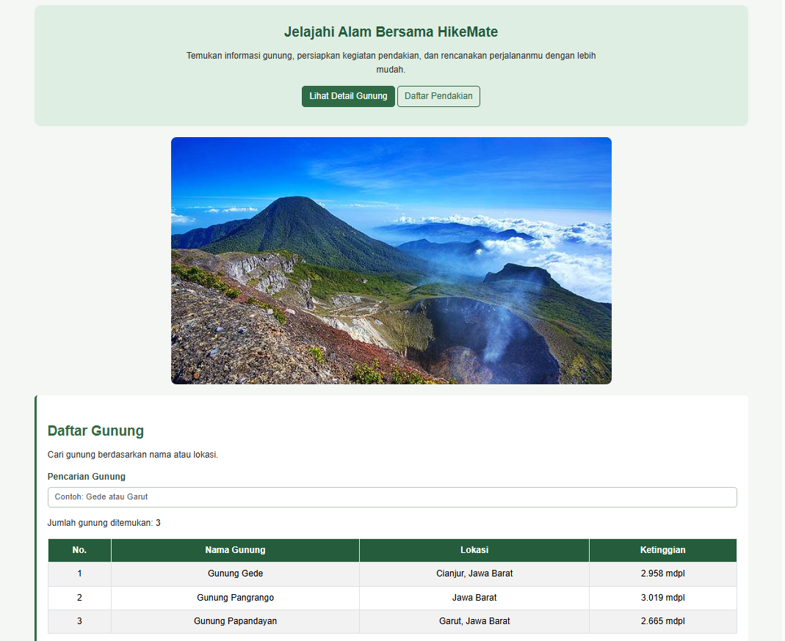
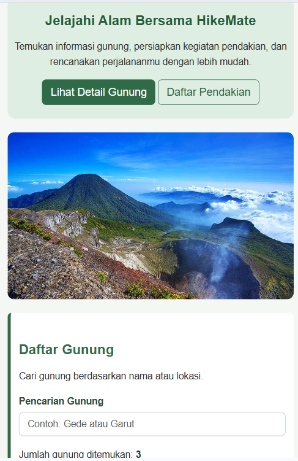

# HikeMate

HikeMate adalah sistem informasi sederhana untuk membantu pengguna
mendapatkan informasi mengenai gunung dan merencanakan kegiatan pendakian.

## Halaman Website

### Beranda
Menampilkan informasi utama dan daftar gunung yang tersedia.

### Detail Gunung
Menampilkan informasi detail mengenai Gunung Gede.

### Daftar Pendakian
Menyediakan formulir untuk mencatat rencana kegiatan pendakian.

## Screenshot

### Beranda

### Detail Gunung

### Daftar Pendakian

## Tugas 3 - CSS

Pada Tugas 3, project HikeMate dikembangkan dengan menerapkan
CSS native menggunakan external stylesheet `style.css`.

Penerapan CSS meliputi:

- Font family, font size, dan font weight
- Styling navigasi dan list
- Text alignment
- Warna background dan teks
- Styling tabel
- Styling form
- Penggunaan div untuk pengelompokan elemen
- Responsive design menggunakan media query

### Screenshot Desktop

### Screenshot Mobile

## Tugas 5 — JavaScript dan jQuery

### Deskripsi
Tugas ini melanjutkan pengembangan HikeMate dengan menambahkan interaktivitas menggunakan JavaScript murni dan jQuery. Data gunung masih berupa data dummy dan belum terhubung ke database.

### Fitur yang Ditambahkan
1. Menampilkan daftar gunung secara dinamis menggunakan JavaScript.
2. Melakukan pencarian gunung berdasarkan nama atau lokasi.
3. Menghitung jumlah hasil pencarian secara otomatis.
4. Menampilkan dan menyembunyikan informasi pendakian menggunakan efek jQuery slideToggle().
5. Memvalidasi formulir pendaftaran pendakian.
6. Menampilkan notifikasi hasil pendaftaran dengan efek fadeIn().

### Teknologi
- HTML5
- CSS3
- Bootstrap 5
- JavaScript
- jQuery 3.7.1

### Cara Menjalankan
1. Clone atau unduh repository HikeMate.
2. Pastikan file index.html, detail-gunung.html, daftar-pendakian.html, style.css, dan script.js tersedia.
3. Buka index.html menggunakan browser.
4. Pastikan koneksi internet tersedia untuk memuat Bootstrap dan jQuery dari CDN.
5. Uji fitur pencarian, tombol informasi, dan formulir pendaftaran.

### Screenshot Desktop

### Screenshot Mobile

### Catatan
Fitur pendaftaran merupakan simulasi frontend. Data tidak disimpan secara permanen dan belum terhubung ke backend atau database.